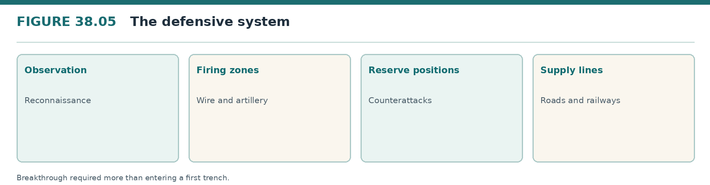

A trench was not simply a long ditch. A mature defensive system could contain frontline positions, communication trenches, reserve lines, dugouts, observation posts, artillery zones and transport routes. Barbed wire slowed attackers while machine guns and artillery punished exposed movement. Defenders could shift reinforcements along railways and roads more easily than an attacker could advance across shell-damaged ground. Thus a local tactical success might fail to become an operational breakthrough.

The balance changed during the war. Artillery techniques improved; aircraft provided reconnaissance; tanks appeared in 1916; infantry and artillery coordinated more effectively; and armies learned how to build defenses in depth. There was no single permanent superiority of defense, and the final campaigns of 1918 featured major advances. Still, military commanders faced a terrible arithmetic: a government might possess enough men and shells to keep attacking without possessing a method for converting casualties into a decisive victory. \[<a href="/038-world-war-i-causes-and-consequences/sources/#source-7" class="cite">7</a>\]\[<a href="/038-world-war-i-causes-and-consequences/sources/#source-9" class="cite">9</a>\]

<figure class="figure" id="figure-38-5">

<figcaption>Figure 38.5. The defensive system <a class="figure-anchor" href="#figure-38-5" aria-label="Link to this figure">#</a></figcaption>
</figure>
