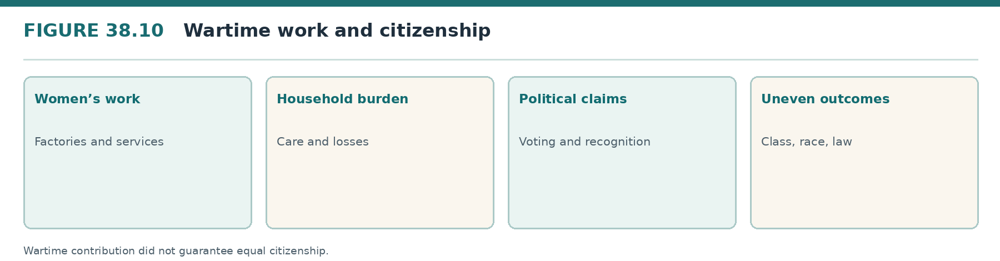

Women served as nurses, clerks, agricultural laborers, transport workers, munitions workers and organizers of welfare and protest movements. Their work sustained armies and households, but wartime employment patterns varied considerably by country, class and region. Some occupations became more accessible, while women could be excluded from higher-status positions or pressured to leave jobs after demobilization. War deaths and injuries left millions of households facing lost earnings, grief and changed family relationships.

It is too simple to claim that World War I immediately liberated women. Suffrage expanded in some countries around the war's end, but campaigns for voting rights long predated 1914, and many women remained politically excluded. Wartime service could strengthen claims for citizenship, yet women in colonial societies and marginalized communities frequently faced additional barriers. Analyze change through specific laws, workplaces and households rather than a general story of inevitable progress. The capacity to contribute to national survival did not automatically produce equal access to the nation’s political institutions. \[<a href="/038-world-war-i-causes-and-consequences/sources/#source-22" class="cite">22</a>\]\[<a href="/038-world-war-i-causes-and-consequences/sources/#source-23" class="cite">23</a>\]

<figure class="figure" id="figure-38-10">

<figcaption>Figure 38.10. Wartime work and citizenship <a class="figure-anchor" href="#figure-38-10" aria-label="Link to this figure">#</a></figcaption>
</figure>
