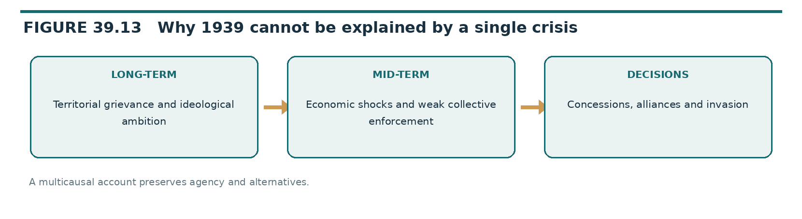

In August 1939 Germany and the Soviet Union concluded a non-aggression pact with secret protocols dividing spheres of influence in eastern Europe. Germany invaded Poland on 1 September 1939; Britain and France declared war on Germany on 3 September. Soviet forces invaded eastern Poland on 17 September. The European interwar period had ended in the outbreak of a new major war, although China and other regions had already been experiencing extensive warfare. Chapter 40 will examine the war and the Holocaust in their full chronology. \[<a href="/039-the-interwar-world/sources/#source-2" class="cite">2</a>\]\[<a href="/039-the-interwar-world/sources/#source-39" class="cite">39</a>\]

The central lesson is not that peace was impossible after 1918. International institutions accomplished real work, societies developed democratic reforms, and many countries maintained constitutional government despite crisis. But unresolved territorial claims, weak collective enforcement, economic interdependence without adequate crisis management, ideological persecution, and calculated aggression proved devastating in combination. A good explanation keeps human choices visible: economic shocks created dangers; regimes and leaders decided how to respond; other governments chose what they would resist or tolerate. This is why the interwar world should be studied not as an inevitable preface, but as a field of possibilities that narrowed over time.

<figure class="figure" id="figure-39-13">

<figcaption>Figure 39.13. Why 1939 cannot be explained by a single crisis. A multicausal account preserves agency and alternatives. <a class="figure-anchor" href="#figure-39-13" aria-label="Link to this figure">#</a></figcaption>
</figure>
