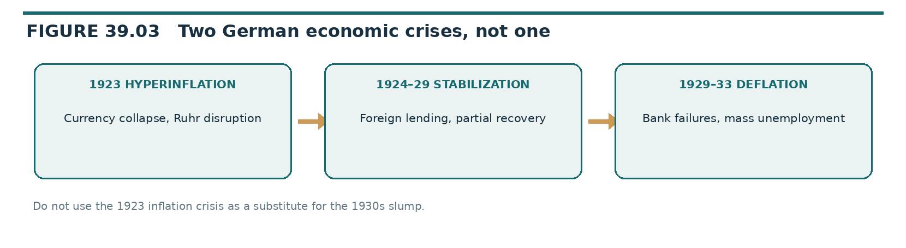

From the middle of the 1920s, many Europeans experienced a meaningful stabilization. The Dawes Plan of 1924 rearranged aspects of Germany's reparations schedule and helped restore international lending; the Locarno agreements of 1925 sought to reduce conflict over Germany's western borders; Germany entered the League of Nations in 1926. International trade and consumer industries grew in parts of the world. The era was neither uniformly prosperous nor a continuous march toward catastrophe. \[<a href="/039-the-interwar-world/sources/#source-1" class="cite">1</a>\]\[<a href="/039-the-interwar-world/sources/#source-7" class="cite">7</a>\]

But stabilization relied partly on credit flows vulnerable to reversal. American capital moved across the Atlantic; European borrowers depended on refinancing; exporters depended on markets that could contract. National economies were connected in complex webs of debts, gold reserves, investment and confidence. The prosperity of a city factory might coexist with declining agricultural incomes, rural migration, and unresolved unemployment. The economic order looked more resilient in the late 1920s than it would prove to be. A reader should avoid two retrospective myths: that everyone flourished in the 'Roaring Twenties,' and that no meaningful progress occurred. \[<a href="/039-the-interwar-world/sources/#source-7" class="cite">7</a>\]\[<a href="/039-the-interwar-world/sources/#source-9" class="cite">9</a>\]

<figure class="figure" id="figure-39-3">

<figcaption>Figure 39.3. Two German economic crises, not one. Do not use the 1923 inflation crisis as a substitute for the 1930s slump. <a class="figure-anchor" href="#figure-39-3" aria-label="Link to this figure">#</a></figcaption>
</figure>
