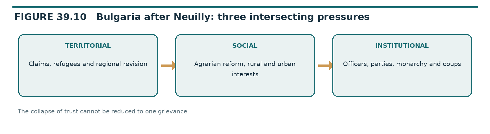

For Bulgaria, the interwar years began after military defeat, territorial losses, reparations obligations, refugee pressures, and political disillusionment. The Treaty of Neuilly of November 1919 imposed conditions and confirmed a difficult regional settlement. Claims concerning Macedonia, Western Thrace, and southern Dobruja remained important in public debate, although the legal position and political status of these territories were not identical. Refugees and veterans carried the consequences of war into communities already burdened by scarcity. \[<a href="/039-the-interwar-world/sources/#source-33" class="cite">33</a>\]\[<a href="/039-the-interwar-world/sources/#source-34" class="cite">34</a>\]

Aleksandar Stamboliyski and the Bulgarian Agrarian National Union advocated a politics centered on peasants, agrarian interests, and reforms that challenged established elites. His government pursued land and educational measures and sought a different regional course, including accommodation with Yugoslavia. Supporters saw democratic social reform for a largely rural population; opponents criticized coercive tendencies, conflicts with the urban elite, and pressure on rival political organizations. Stamboliyski cannot be accurately described merely as either a flawless democrat or an ordinary authoritarian. His policies and methods require separate analysis. \[<a href="/039-the-interwar-world/sources/#source-33" class="cite">33</a>\]\[<a href="/039-the-interwar-world/sources/#source-34" class="cite">34</a>\]

<figure class="figure" id="figure-39-10">

<figcaption>Figure 39.10. Bulgaria after Neuilly: three intersecting pressures. The collapse of trust cannot be reduced to one grievance. <a class="figure-anchor" href="#figure-39-10" aria-label="Link to this figure">#</a></figcaption>
</figure>
