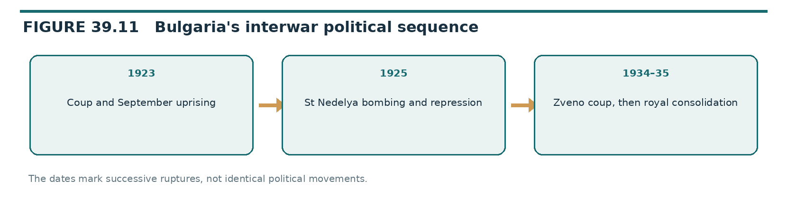

Bulgaria's economy remained heavily agrarian and vulnerable to international commodity prices. Global depression strained farmers, trade and public finance, although the experience differed from industrial mass unemployment in Germany or the United States. Political coalitions remained fragile. On 19 May 1934 the Zveno political circle and Military League staged another coup, under Kimon Georgiev. The new rulers suspended parliamentary competition and pursued administrative centralization, while taking steps against organizations that challenged their authority. \[<a href="/039-the-interwar-world/sources/#source-34" class="cite">34</a>\]\[<a href="/039-the-interwar-world/sources/#source-36" class="cite">36</a>\]

Tsar Boris III gradually displaced the coup-makers and consolidated a more personal royal rule from 1935, rather than returning Bulgaria to ordinary competitive parliamentary government. Foreign policy increasingly focused on peaceful territorial revision and maintaining room to maneuver amid rival great powers. The monarchy's course was constrained by security fears and economic dependence, but constrained choices were still choices. In 1939 Bulgaria had not yet entered World War II; its later wartime alliance and the experiences of Bulgarian Jews belong to the next chapter. Interwar Bulgaria illustrates how regional grievances, military intervention, social conflict, and institutional distrust interacted without making any single outcome inevitable. \[<a href="/039-the-interwar-world/sources/#source-34" class="cite">34</a>\]\[<a href="/039-the-interwar-world/sources/#source-36" class="cite">36</a>\]

<figure class="figure" id="figure-39-11">

<figcaption>Figure 39.11. Bulgaria's interwar political sequence. The dates mark successive ruptures, not identical political movements. <a class="figure-anchor" href="#figure-39-11" aria-label="Link to this figure">#</a></figcaption>
</figure>
