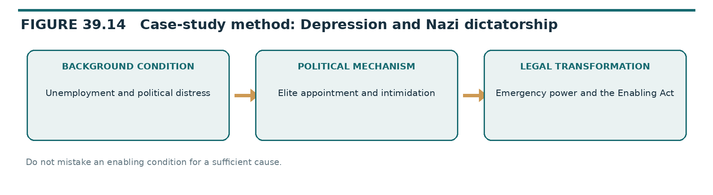

Suppose someone claims, 'The 1929 crash caused Hitler to become dictator.' The claim contains a crucial truth but oversimplifies several steps. Economic collapse increased unemployment and strengthened extreme parties; Nazi electoral support rose sharply after 1929. Yet Hitler was not elected dictator by a majority vote. President Hindenburg appointed him chancellor in January 1933 after elite political bargaining. Nazi violence, emergency decrees, the intimidation surrounding the March election, and the Enabling Act helped destroy constitutional government. The Depression was a major enabling condition, not a sufficient explanation on its own. \[<a href="/039-the-interwar-world/sources/#source-12" class="cite">12</a>\]\[<a href="/039-the-interwar-world/sources/#source-13" class="cite">13</a>\]\[<a href="/039-the-interwar-world/sources/#source-23" class="cite">23</a>\]

Test this claim by comparing cases: Why did Britain or Sweden not follow the same path? Why did Italy become fascist before the Depression? Why did elite decisions in Germany matter in January 1933? Distinguish correlation, background pressure, political mechanisms, and legal steps. This is the reasoning habit we introduced in Chapter 1: an explanation is stronger when it accounts for outcomes and credible alternatives, rather than selecting one dramatic fact and calling it the whole cause.

<figure class="figure" id="figure-39-14">

<figcaption>Figure 39.14. Case-study method: Depression and Nazi dictatorship. Do not mistake an enabling condition for a sufficient cause. <a class="figure-anchor" href="#figure-39-14" aria-label="Link to this figure">#</a></figcaption>
</figure>
