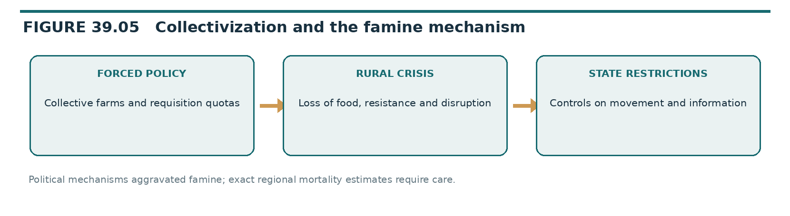

Collectivization aimed to reorganize peasant farms into state-directed collective structures and to control agricultural procurement. Resistance, confiscation, deportation, unrealistic quotas, and coercion devastated rural communities. In 1932–1933 catastrophic famine struck Ukraine and other Soviet regions, including Kazakhstan and parts of Russia. The Ukrainian catastrophe is known as the <em>Holodomor</em>. Scholarly demographic reconstructions differ, and death totals should always specify their geographic and methodological scope; millions perished. \[<a href="/039-the-interwar-world/sources/#source-20" class="cite">20</a>\]\[<a href="/039-the-interwar-world/sources/#source-21" class="cite">21</a>\]

There is strong evidence that Stalinist policy caused and aggravated the famine through forced collectivization, procurement demands, movement restrictions, and suppression of information. Scholars differ over the precise timing of leadership intentions and the characterization of particular policies as a specifically targeted genocide; Ukraine and numerous governments recognize the Holodomor as genocide. Presenting this dispute responsibly requires neither pretending no intention existed nor assuming every archival question has been settled. Grain requisitioning and bureaucratic coercion were not accidents of weather. Political power shaped who could eat and who could leave. \[<a href="/039-the-interwar-world/sources/#source-21" class="cite">21</a>\]\[<a href="/039-the-interwar-world/sources/#source-22" class="cite">22</a>\]

<figure class="figure" id="figure-39-5">

<figcaption>Figure 39.5. Collectivization and the famine mechanism. Political mechanisms aggravated famine; exact regional mortality estimates require care. <a class="figure-anchor" href="#figure-39-5" aria-label="Link to this figure">#</a></figcaption>
</figure>
