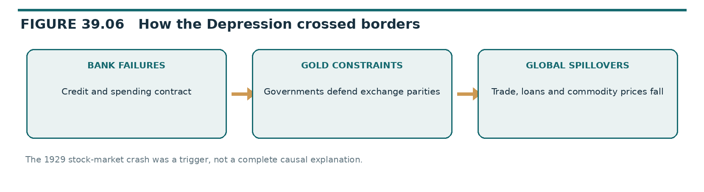

The international gold standard transmitted deflationary pressures by tying currency and monetary choices to gold reserves and exchange commitments. When governments defended parities, they often raised interest rates or restricted credit even as unemployment rose. Financial shocks traveled through cross-border lending. Trade shrank, while tariff increases and retaliatory restrictions compounded the damage; the relationship between trade protection and depression was important but not a one-cause explanation. Britain left gold in September 1931, and the United States changed its monetary regime in 1933. \[<a href="/039-the-interwar-world/sources/#source-7" class="cite">7</a>\]\[<a href="/039-the-interwar-world/sources/#source-9" class="cite">9</a>\]\[<a href="/039-the-interwar-world/sources/#source-23" class="cite">23</a>\]

The timing of recovery varied. Countries that loosened monetary constraints often recovered earlier, although domestic institutions, fiscal policy, banking reform, and international demand also mattered. For Germany, the loss of foreign loans and collapse of employment proved politically destabilizing. Agricultural exporters in Latin America and colonial economies experienced falling commodity prices and shrinking government revenue. The economic catastrophe was global, but the tools and political space available to governments were unevenly distributed. \[<a href="/039-the-interwar-world/sources/#source-7" class="cite">7</a>\]\[<a href="/039-the-interwar-world/sources/#source-9" class="cite">9</a>\]

<figure class="figure" id="figure-39-6">

<figcaption>Figure 39.6. How the Depression crossed borders. The 1929 stock-market crash was a trigger, not a complete causal explanation. <a class="figure-anchor" href="#figure-39-6" aria-label="Link to this figure">#</a></figcaption>
</figure>
