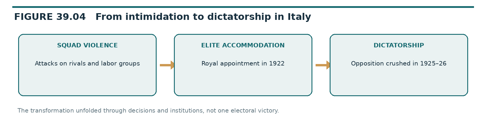

Italy had fought on the winning side in the First World War, yet unemployment, labor conflict, veteran grievances, fears of revolution, and disputes over territorial rewards weakened liberal governments. Benito Mussolini's Fascist movement organized violent squads that attacked socialists, trade unionists, and opponents. Some landowners, employers, and conservative figures tolerated or supported the squads as a defense against the left. The so-called March on Rome in October 1922 involved pressure and mobilization, but Mussolini was appointed prime minister by King Victor Emmanuel III rather than winning power through a conventional election majority. \[<a href="/039-the-interwar-world/sources/#source-17" class="cite">17</a>\]

A dictatorship took shape in stages. After the 1924 murder of socialist deputy Giacomo Matteotti, fascist leaders faced a crisis; in 1925–1926 Mussolini dismantled much of the remaining political opposition and free press. Fascism constructed mass organizations, censorship, police powers, and a cult of leadership. It also pursued aggressive nationalism and ultimately colonial war. The lesson is not that the Italian state simply collapsed in one dramatic weekend: institutions, political elites, organized violence, and calculated accommodation helped turn a parliamentary appointment into dictatorship. \[<a href="/039-the-interwar-world/sources/#source-17" class="cite">17</a>\]\[<a href="/039-the-interwar-world/sources/#source-18" class="cite">18</a>\]

<figure class="figure" id="figure-39-4">

<figcaption>Figure 39.4. From intimidation to dictatorship in Italy. The transformation unfolded through decisions and institutions, not one electoral victory. <a class="figure-anchor" href="#figure-39-4" aria-label="Link to this figure">#</a></figcaption>
</figure>
