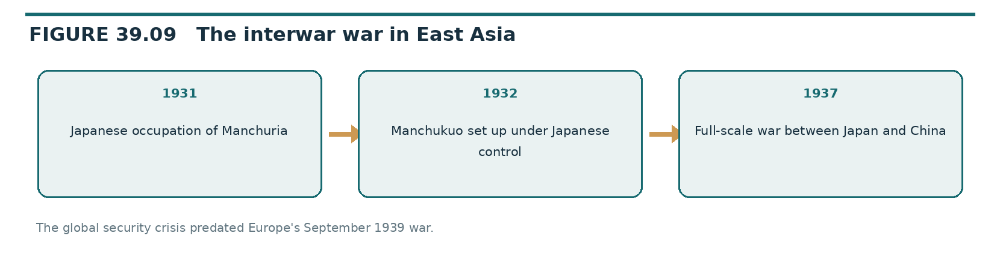

Japan entered the interwar era as an industrial and imperial power with formal parliamentary institutions, a powerful military establishment, and expanding interests in Korea and China. Civilian governments operated under constraints, and military officers increasingly pursued policies beyond effective party control. In September 1931 Japanese officers engineered an incident on the South Manchurian Railway and used it as a pretext for occupying Manchuria. The puppet state of Manchukuo was established in 1932. \[<a href="/039-the-interwar-world/sources/#source-30" class="cite">30</a>\]

The League's investigation rejected the idea that the new arrangement represented free local self-determination, but its response failed to reverse the conquest. Japan withdrew from the League after criticism. In 1937 full-scale war broke out between Japan and China following renewed fighting near Beijing. The conflict expanded into mass violence against civilians, including atrocities during the capture of Nanjing. These events show why a book organized around European wars must not treat Asia as merely a distant theater awaiting 1941. The international order was already breaking down in East Asia. \[<a href="/039-the-interwar-world/sources/#source-5" class="cite">5</a>\]\[<a href="/039-the-interwar-world/sources/#source-30" class="cite">30</a>\]

<figure class="figure" id="figure-39-9">

<figcaption>Figure 39.9. The interwar war in East Asia. The global security crisis predated Europe's September 1939 war. <a class="figure-anchor" href="#figure-39-9" aria-label="Link to this figure">#</a></figcaption>
</figure>
