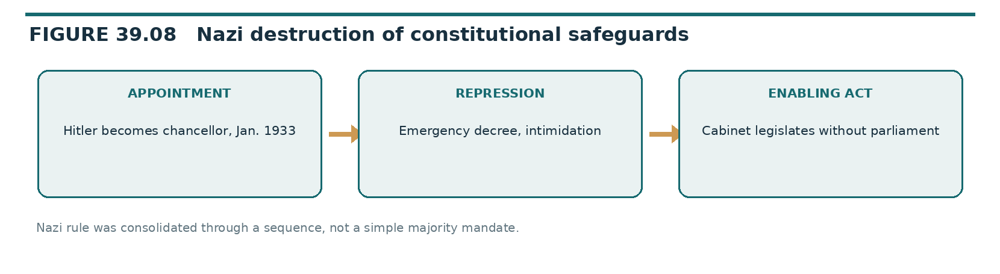

Nazi ideology defined the nation through a racial hierarchy and portrayed Jews as a fabricated, dangerous enemy. Persecution began before World War II and escalated through public boycotts, dismissals, exclusion from professions and schools, and increasingly systematic legal discrimination. The Nuremberg Laws of September 1935 formalized racialized citizenship and restrictions on marriage and relationships. A person could be persecuted not because of personal belief or conduct but because the state classified ancestry according to racist rules. \[<a href="/039-the-interwar-world/sources/#source-27" class="cite">27</a>\]

On 9–10 November 1938, a coordinated wave of anti-Jewish violence known as Kristallnacht devastated synagogues, shops, and homes while tens of thousands of Jewish men were arrested. The pogrom revealed the regime's willingness to make mass public violence part of state policy. Not every later wartime development had been fully decided in 1933, and the Holocaust must be studied in its own chronology in Chapter 40. But the ideological and institutional foundations of persecution were already firmly visible in the interwar period. \[<a href="/039-the-interwar-world/sources/#source-27" class="cite">27</a>\]\[<a href="/039-the-interwar-world/sources/#source-28" class="cite">28</a>\]

<figure class="figure" id="figure-39-8">

<figcaption>Figure 39.8. Nazi destruction of constitutional safeguards. Nazi rule was consolidated through a sequence, not a simple majority mandate. <a class="figure-anchor" href="#figure-39-8" aria-label="Link to this figure">#</a></figcaption>
</figure>
