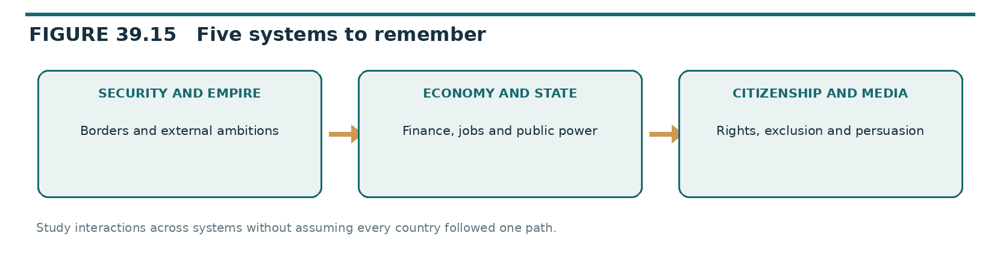

By 1939 five major systems had been transformed. The international security system had lost credibility in key confrontations. The economic system had suffered an extraordinary global breakdown, and governments adopted different remedies. Political systems showed divergent possibilities: democratic innovation, military rule, fascist and Nazi dictatorship, and Stalinist one-party terror. Empires faced increasingly organized anticolonial movements, while imperial Japan and European powers pursued further expansion. Mass media, education, and culture increased society's capacity both for public participation and state-directed persuasion. \[<a href="/039-the-interwar-world/sources/#source-1" class="cite">1</a>\]\[<a href="/039-the-interwar-world/sources/#source-2" class="cite">2</a>\]

Keep five questions in mind: What changed economically? Who controlled institutions of force? How inclusive was citizenship? What commitments could international organizations enforce? Which groups were permitted to participate in politics without fear? These questions connect the interwar story to the later chapters on war, ideology, economics, public life, and the geography of power. There is no need to pretend that a single formula explains every country. The strongest general lesson is to examine the interaction of systems without erasing the people who acted within them.

<figure class="figure" id="figure-39-15">

<figcaption>Figure 39.15. Five systems to remember. Study interactions across systems without assuming every country followed one path. <a class="figure-anchor" href="#figure-39-15" aria-label="Link to this figure">#</a></figcaption>
</figure>
