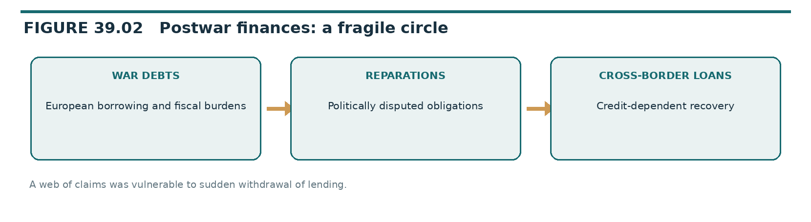

The war also rearranged global finance. Governments borrowed on a scale that was difficult to sustain; currencies experienced inflation or instability; and the United States held major claims on European debtors. Germany's reparations were connected in public debate and financial practice to the problem of Allied war debts, although the legal obligations were not identical. New states inherited fragmented railways, customs systems, banks, and markets that had once operated across imperial borders. Peace did not return economic life to 1913 conditions. \[<a href="/039-the-interwar-world/sources/#source-7" class="cite">7</a>\]\[<a href="/039-the-interwar-world/sources/#source-8" class="cite">8</a>\]

In some countries the return to prewar gold parities became a policy goal. A gold standard promised credibility by limiting exchange-rate movement, but it also constrained central banks when falling prices and unemployment called for monetary flexibility. States faced competing interests: lenders wanted stable currency; farmers wanted better prices; exporters wanted competitiveness; workers wanted jobs and purchasing power. The eventual Depression is easier to understand if these conflicts are treated as institutions and political choices, not merely the aftermath of one sensational day on Wall Street. \[<a href="/039-the-interwar-world/sources/#source-7" class="cite">7</a>\]\[<a href="/039-the-interwar-world/sources/#source-9" class="cite">9</a>\]

<figure class="figure" id="figure-39-2">

<figcaption>Figure 39.2. Postwar finances: a fragile circle. A web of claims was vulnerable to sudden withdrawal of lending. <a class="figure-anchor" href="#figure-39-2" aria-label="Link to this figure">#</a></figcaption>
</figure>
