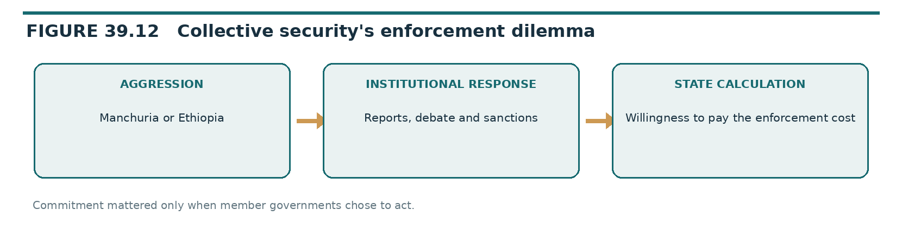

During the 1930s Nazi Germany pursued revision and conquest, rearmed, and undermined the European security order. Germany openly reintroduced conscription in 1935 and remilitarized the Rhineland in March 1936. Italy attacked Ethiopia; Germany and Italy developed closer relations; Japan pressed ahead in China. The Spanish Civil War brought foreign combatants and military assistance into a conflict that the European democracies struggled to contain. International crises accumulated, but their order and effects must be traced carefully rather than described as one uninterrupted master plan. \[<a href="/039-the-interwar-world/sources/#source-2" class="cite">2</a>\]\[<a href="/039-the-interwar-world/sources/#source-5" class="cite">5</a>\]

Foreign governments responded through a mixture of protests, negotiation, sanctions, domestic rearmament, and attempted accommodation. Each decision changed what leaders believed their opponents might do next. The memory of the First World War shaped public reluctance to fight, and strategic concerns made some governments question whether their armed forces were ready. Those pressures help explain behavior but do not automatically vindicate decisions that sacrificed other countries' security. Historical explanation is not the same as retrospective approval. \[<a href="/039-the-interwar-world/sources/#source-2" class="cite">2</a>\]\[<a href="/039-the-interwar-world/sources/#source-37" class="cite">37</a>\]

<figure class="figure" id="figure-39-12">

<figcaption>Figure 39.12. Collective security's enforcement dilemma. Commitment mattered only when member governments chose to act. <a class="figure-anchor" href="#figure-39-12" aria-label="Link to this figure">#</a></figcaption>
</figure>
