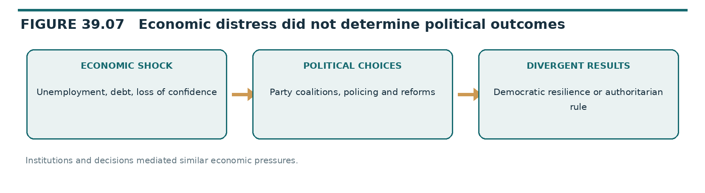

Economic crisis weakened established parties and made promises of national salvation emotionally powerful. It also expanded the audience for conspiracy theories blaming outsiders, minorities, financiers, or invented internal enemies. But it is wrong to argue that unemployment alone explains fascism. Italy's fascist takeover preceded the Great Depression; some countries endured severe economic distress while maintaining parliamentary government. Political institutions, elites, violence, propaganda, historical grievances, and specific decisions were decisive variables. \[<a href="/039-the-interwar-world/sources/#source-12" class="cite">12</a>\]\[<a href="/039-the-interwar-world/sources/#source-18" class="cite">18</a>\]

A useful comparison asks why governments facing similar pressures chose different paths. Did officers remain loyal to constitutional authority? Could parties form credible coalitions? Did employers or landowners finance anti-democratic movements? Were newspapers independent? Were emergency powers constrained? How did international obligations affect domestic confidence? Answering these questions helps transform a vague story about 'hard times' into a historical explanation about competing institutions and agency. It also prevents the misleading assumption that people in economic distress necessarily prefer dictatorship. \[<a href="/039-the-interwar-world/sources/#source-12" class="cite">12</a>\]\[<a href="/039-the-interwar-world/sources/#source-13" class="cite">13</a>\]

<figure class="figure" id="figure-39-7">

<figcaption>Figure 39.7. Economic distress did not determine political outcomes. Institutions and decisions mediated similar economic pressures. <a class="figure-anchor" href="#figure-39-7" aria-label="Link to this figure">#</a></figcaption>
</figure>
