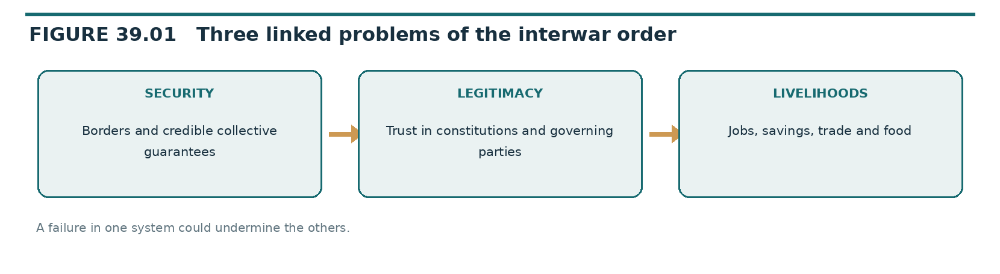

The war had damaged three interconnected foundations of political stability. <em>Security</em> concerned whether states could defend their borders without provoking new conflict. <em>Legitimacy</em> concerned whether citizens regarded parliaments, monarchies, or revolutionary governments as entitled to rule. <em>Livelihoods</em> concerned jobs, prices, land, savings, and the ability to feed a household. Even a government that solved one problem could fail because of another. A frontier guarantee was worth less if voters distrusted the cabinet that promised to uphold it. Economic recovery could be overwhelmed by a new banking panic or a coup.

Different regions experienced this crisis differently. The United States emerged as a major creditor and industrial power. Germany became a republic after imperial defeat. Austria-Hungary and the Ottoman Empire broke apart into different political arrangements; the Russian Empire was replaced by a revolutionary Soviet state. In Asia, Japanese imperial ambitions and Chinese struggles for national unification produced their own conflicts. European colonies in Africa and Asia saw promises of self-determination applied selectively. Historians must therefore study the 1920s and 1930s as a connected world, not simply the prehistory of Hitler's invasion of Poland. \[<a href="/039-the-interwar-world/sources/#source-1" class="cite">1</a>\]\[<a href="/039-the-interwar-world/sources/#source-3" class="cite">3</a>\]

<figure class="figure" id="figure-39-1">

<figcaption>Figure 39.1. Three linked problems of the interwar order. A failure in one system could undermine the others. <a class="figure-anchor" href="#figure-39-1" aria-label="Link to this figure">#</a></figcaption>
</figure>
