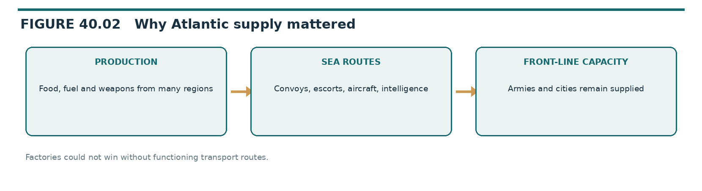

Germany sought air superiority over Britain in 1940, while the Royal Air Force used radar-supported early warning, fighter control and an expanding aircraft-production effort to resist. The Battle of Britain did not end the danger to civilians. German bombing of cities during the Blitz killed and injured thousands, destroyed homes and altered daily life. Britain relied on food imports, petroleum and military supplies arriving by sea. Control of the Channel mattered, but so did the much larger battle to keep Atlantic shipping functioning.

German submarines threatened merchant convoys; Allied responses combined escorts, aircraft, intelligence, codebreaking, improved radar and steadily increased shipbuilding. The Battle of the Atlantic lasted across much of the war and demonstrates why production and transport cannot be separated from combat. A factory's tank is of limited use if it cannot reach a front, and a population's wartime resilience is reduced if imports of food and fuel fail. Britain's survival in 1940 also depended on imperial and Commonwealth resources. Recognizing that support avoids reducing the war to the decisions of a few European capitals. \[<a href="/040-world-war-ii-and-the-holocaust/sources/#source-3" class="cite">3</a>\]\[<a href="/040-world-war-ii-and-the-holocaust/sources/#source-7" class="cite">7</a>\]

<figure class="figure" id="figure-40-2">

<figcaption>Figure 40.2. Why Atlantic supply mattered. Factories could not win without functioning transport routes. <a class="figure-anchor" href="#figure-40-2" aria-label="Link to this figure">#</a></figcaption>
</figure>
