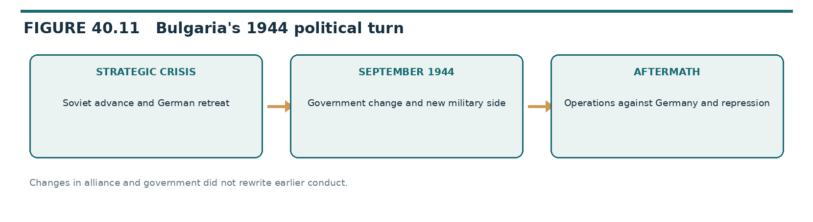

Bulgaria's wartime position became unsustainable as Germany retreated and the Soviet Union approached southeastern Europe. Following political upheaval, the Soviet Union declared war on Bulgaria in September 1944 despite Bulgaria's earlier avoidance of combat against Soviet forces. On 9 September a Fatherland Front takeover, supported by political and military actors and the presence of Soviet forces, brought a new government to power. Bulgaria then fought against Germany, including operations in Yugoslavia and Hungary. The change in military alignment did not remove the country's earlier responsibility for occupation policies or wartime antisemitism.

The transition also opened a period of purges, political trials and rapidly increasing Communist influence. The People's Court, established under the new authorities, carried out prosecutions and executions amid deeply contested questions of procedure and justice. After the war Bulgaria retained Southern Dobruja but lost control of wartime-occupied territories. Interpreting September 1944 as only liberation or only occupation erases genuine political conflict and differing experiences. A careful account should state the military facts, the domestic seizure of power, the subsequent repression and the emerging Soviet sphere of influence separately. \[<a href="/040-world-war-ii-and-the-holocaust/sources/#source-26" class="cite">26</a>\]\[<a href="/040-world-war-ii-and-the-holocaust/sources/#source-34" class="cite">34</a>\]

<figure class="figure" id="figure-40-11">

<figcaption>Figure 40.11. Bulgaria's 1944 political turn. Changes in alliance and government did not rewrite earlier conduct. <a class="figure-anchor" href="#figure-40-11" aria-label="Link to this figure">#</a></figcaption>
</figure>
