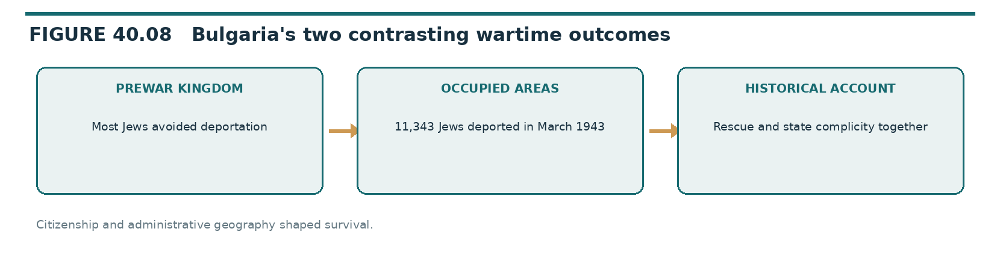

In March 1943 Bulgarian police and military authorities rounded up and deported 11,343 Jews from Bulgarian-occupied territories of Vardar Macedonia, Thrace and Pirot. They were transferred into German custody and nearly all were murdered, many at Treblinka. This was a grave crime in which Bulgarian state institutions played a direct role. The deportation from those territories must not be hidden behind the familiar narrative that Bulgaria 'saved its Jews.' It matters exactly which people were included in the country before the war and which inhabitants of occupied areas were denied equal protection.

Planned deportations of Jews living inside Bulgaria's prewar borders did not proceed. Intervention by politicians including Dimitar Peshev, Bulgarian Orthodox clergy, some intellectuals, community networks and others contributed to resistance, while the motives and role of King Boris III remain subjects of historical debate. Most Jews within the prewar kingdom survived, though they endured discriminatory laws, forced labor, confiscation and internal displacement. The historically responsible statement is two-part: substantial rescue occurred within the old kingdom, and authorities were complicit in deadly deportations from occupied territory. These facts coexist. \[<a href="/040-world-war-ii-and-the-holocaust/sources/#source-26" class="cite">26</a>\]\[<a href="/040-world-war-ii-and-the-holocaust/sources/#source-27" class="cite">27</a>\]

<figure class="figure" id="figure-40-8">

<figcaption>Figure 40.8. Bulgaria's two contrasting wartime outcomes. Citizenship and administrative geography shaped survival. <a class="figure-anchor" href="#figure-40-8" aria-label="Link to this figure">#</a></figcaption>
</figure>
