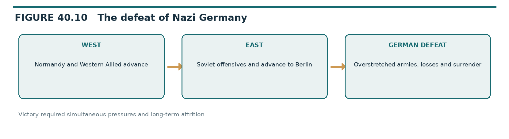

On 6 June 1944 Western Allied forces landed in Normandy in a vast amphibious and airborne operation supported by aircraft, ships, engineering, deception and supply planning. The landings created a major front in northwestern Europe, but victory depended on the costly breakout from Normandy, the liberation of Paris and continued operations toward Germany. French resistance groups and Free French forces played important roles. Allied strategy had to maintain cooperation among national armies and build pipelines, ports and roads capable of supplying advancing troops.

The Normandy landings were a crucial contribution, but they must not displace the Soviet war on the Eastern Front, the struggle in Italy, or the years of resistance in occupied countries. Different national commemorations emphasize different battles, often for understandable reasons of local sacrifice. A global explanation asks how the fronts interacted. The Red Army's major summer 1944 offensive against German forces in Belarus inflicted catastrophic losses at roughly the same time as the Normandy campaign. Germany had to confront major offensives from different directions under increasingly severe supply constraints. \[<a href="/040-world-war-ii-and-the-holocaust/sources/#source-3" class="cite">3</a>\]\[<a href="/040-world-war-ii-and-the-holocaust/sources/#source-32" class="cite">32</a>\]

<figure class="figure" id="figure-40-10">

<figcaption>Figure 40.10. The defeat of Nazi Germany. Victory required simultaneous pressures and long-term attrition. <a class="figure-anchor" href="#figure-40-10" aria-label="Link to this figure">#</a></figcaption>
</figure>
