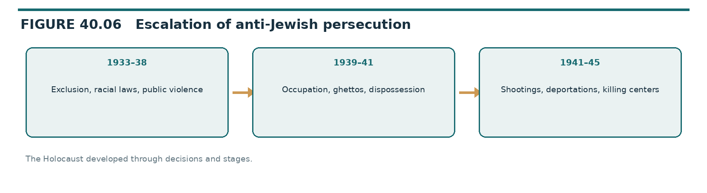

The Warsaw and Łódź ghettos are among the best-known examples, but Nazi authorities confined Jews in many occupied towns and cities. Families struggled with inadequate shelter, limited food, forced work, epidemic disease and arbitrary violence. Jewish councils faced coercive administrative demands under conditions created by the occupiers; their actions cannot be evaluated as if they possessed normal sovereignty. Smuggling, mutual aid, clandestine teaching, religious practice and underground archives were acts through which people sought to sustain life and preserve testimony.

Nazi and collaborating officials used rail schedules, registration lists, police orders and bureaucratic euphemisms to coordinate deportations. A seemingly neutral transport document could be part of a killing process. Bureaucracy did not reduce moral responsibility; it distributed actions across offices so that many people could claim to be performing only their individual task. The clandestine Oneg Shabbat archive, created within the Warsaw Ghetto, shows why testimony matters: people attempted to preserve an evidentiary record while the events were still unfolding, even though they could not know whether they would survive. \[<a href="/040-world-war-ii-and-the-holocaust/sources/#source-19" class="cite">19</a>\]\[<a href="/040-world-war-ii-and-the-holocaust/sources/#source-21" class="cite">21</a>\]

<figure class="figure" id="figure-40-6">

<figcaption>Figure 40.6. Escalation of anti-Jewish persecution. The Holocaust developed through decisions and stages. <a class="figure-anchor" href="#figure-40-6" aria-label="Link to this figure">#</a></figcaption>
</figure>
