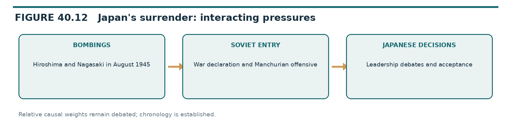

On 6 August 1945 the United States dropped an atomic bomb on Hiroshima; on 9 August another struck Nagasaki. The blasts killed large numbers of civilians immediately, and burns, radiation exposure and destroyed medical infrastructure caused further deaths. The United States had developed the bombs through a vast scientific, industrial and military program known as the Manhattan Project. American leaders argued that using them could hasten Japan's surrender and avoid still more deaths. Other contemporary voices and later scholars have challenged their necessity, target choice and morality.

Any claim that the bombs were the single cause of surrender oversimplifies August 1945. The Soviet Union declared war on Japan on 8 August and began a major offensive in Manchuria. Japan faced a collapsing strategic position, blockade, firebombing, an uncertain prospect of negotiated terms and a divided leadership. Emperor Hirohito announced acceptance of surrender in mid-August, and formal documents were signed on 2 September 1945. Historians disagree on the relative influence of the atomic bombings and Soviet entry. What is established is the sequence of events, the devastation of the bombed cities and the extraordinary stakes of the decisions. \[<a href="/040-world-war-ii-and-the-holocaust/sources/#source-16" class="cite">16</a>\]\[<a href="/040-world-war-ii-and-the-holocaust/sources/#source-35" class="cite">35</a>\]

<figure class="figure" id="figure-40-12">

<figcaption>Figure 40.12. Japan's surrender: interacting pressures. Relative causal weights remain debated; chronology is established. <a class="figure-anchor" href="#figure-40-12" aria-label="Link to this figure">#</a></figcaption>
</figure>
