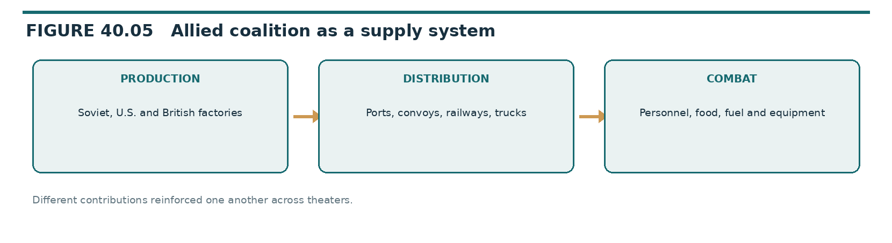

Military coalitions face a fundamental coordination problem: each government wants victory but has different security needs, ideological commitments and fears. Britain prioritized survival, Atlantic shipping and Mediterranean strategy. The Soviet Union demanded pressure on Germany in Europe while fighting enormous land campaigns. The United States had to allocate shipping, factories and forces between Germany and Japan. China fought for its survival and international recognition. Allied conferences created coordination but never eliminated disagreement over timing, postwar borders or political legitimacy.

American Lend-Lease sent vehicles, fuel, food, metals and equipment to Allied countries, while Soviet factories produced vast quantities of weapons and Britain and the Commonwealth maintained sea and air operations. Logistics linked these contributions: trucks carrying supplies could alter operational mobility even when they were not the principal weapons in photographs. Governments also relied on colonial soldiers and workers whose political rights remained unequal. The Allied war effort was therefore a coalition of state interests and human contributions, not a monolithic army advancing under one unified ideology. \[<a href="/040-world-war-ii-and-the-holocaust/sources/#source-3" class="cite">3</a>\]\[<a href="/040-world-war-ii-and-the-holocaust/sources/#source-18" class="cite">18</a>\]

<figure class="figure" id="figure-40-5">

<figcaption>Figure 40.5. Allied coalition as a supply system. Different contributions reinforced one another across theaters. <a class="figure-anchor" href="#figure-40-5" aria-label="Link to this figure">#</a></figcaption>
</figure>
