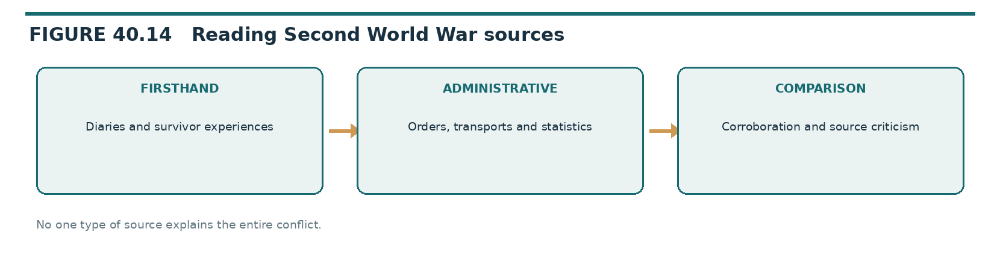

World War II generated orders, photographs, private letters, radio broadcasts, intelligence records, industrial statistics, camp registers and millions of memories. These sources are valuable but not interchangeable. An official communiqué may show what a government wanted the public to believe, not what actually happened on a battlefield. A survivor's account documents lived experience while naturally reflecting one limited vantage point. A weapons-production table can measure output but not explain civilian hunger. Comparison among independent types of evidence is essential.

Historical debates about strategic bombing, intelligence, military leadership and diplomatic decisions are legitimate when they draw on evidence. Holocaust denial and fabricated claims of wartime innocence are not simply alternative 'opinions' of equal standing. They ignore overwhelming documentation or selectively suppress the victims and acts of perpetrators. Public memory can also become distorted without deliberate denial, when national commemorations exclude unpopular episodes of collaboration or crimes. Good historical practice preserves the achievements of resistance while confronting the failures of authorities and societies, including one's own. \[<a href="/040-world-war-ii-and-the-holocaust/sources/#source-19" class="cite">19</a>\]\[<a href="/040-world-war-ii-and-the-holocaust/sources/#source-20" class="cite">20</a>\]

<figure class="figure" id="figure-40-14">

<figcaption>Figure 40.14. Reading Second World War sources. No one type of source explains the entire conflict. <a class="figure-anchor" href="#figure-40-14" aria-label="Link to this figure">#</a></figcaption>
</figure>
