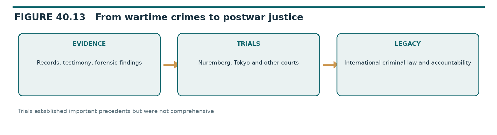

After the defeat of the Axis powers, international and national courts prosecuted some senior officials and other perpetrators. The International Military Tribunal at Nuremberg addressed crimes against peace, war crimes and crimes against humanity; later proceedings investigated doctors, judges, industrialists and additional defendants. The Tokyo tribunal and other trials considered Japanese leaders and wartime atrocities in Asia. These legal developments created enduring precedents, even though they were imperfect and did not prosecute every responsible person.

Critics noted that courts convened by victorious powers could not fully escape the problem of selective justice. Yet the trials documented immense quantities of evidence and established that official rank or state orders did not automatically eliminate personal criminal responsibility. The legal categories later developed through new conventions and institutions, including the 1948 Genocide Convention. The pursuit of justice was therefore both an immediate response to crimes and the beginning of a much longer, contested effort to make international criminal law effective. \[<a href="/040-world-war-ii-and-the-holocaust/sources/#source-20" class="cite">20</a>\]\[<a href="/040-world-war-ii-and-the-holocaust/sources/#source-33" class="cite">33</a>\]

<figure class="figure" id="figure-40-13">

<figcaption>Figure 40.13. From wartime crimes to postwar justice. Trials established important precedents but were not comprehensive. <a class="figure-anchor" href="#figure-40-13" aria-label="Link to this figure">#</a></figcaption>
</figure>
