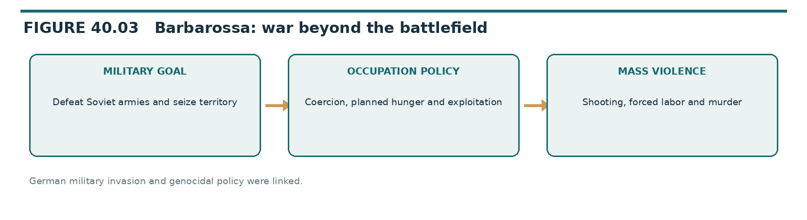

On 22 June 1941 Nazi Germany and its allies attacked the Soviet Union. The campaign was far more than a conventional border war. Nazi leadership imagined the conquest of eastern territory for German settlement, exploitation of food and resources, destruction of Bolshevism, and the removal or subjugation of populations classified as racially inferior. German units and occupation authorities carried out mass killing of civilians, Jews, Roma and prisoners of war. Starvation was not simply an incidental logistical problem; planners envisaged policies that would divert food away from large occupied populations.

German armies made dramatic initial advances and surrounded Soviet forces, but distance, resistance, supply constraints, industrial mobilization and weather combined to obstruct a quick victory. The Soviet government moved factories east and mobilized enormous human resources, often through both patriotic appeals and coercive state measures. The battles around Moscow in late 1941 ended the prospect of a simple early collapse. This theater became the largest and bloodiest struggle in Europe, but the Soviet contribution cannot be captured by a single casualty statistic: it included soldiers, industrial workers, evacuees, partisans and civilians surviving occupation and siege. \[<a href="/040-world-war-ii-and-the-holocaust/sources/#source-11" class="cite">11</a>\]\[<a href="/040-world-war-ii-and-the-holocaust/sources/#source-12" class="cite">12</a>\]

<figure class="figure" id="figure-40-3">

<figcaption>Figure 40.3. Barbarossa: war beyond the battlefield. German military invasion and genocidal policy were linked. <a class="figure-anchor" href="#figure-40-3" aria-label="Link to this figure">#</a></figcaption>
</figure>
