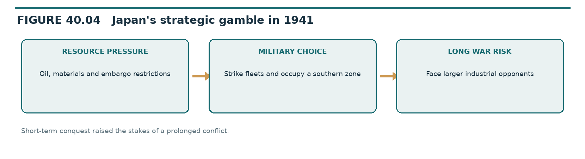

Japanese strategic planners feared that restrictions on oil and other imports would undermine their military ambitions in China and Southeast Asia. They decided on attacks designed to neutralize opponents while Japan seized territories considered essential to an imperial resource zone. On 7 December 1941 Japanese aircraft attacked the United States Pacific Fleet at Pearl Harbor. Japan simultaneously launched offensives across Southeast Asia and the Pacific, including attacks on British and American positions. The United States entered the war against Japan, and Germany and Italy declared war on the United States days later.

The opening Japanese offensives conquered Malaya, Singapore, the Philippines, the Dutch East Indies and other territories with astonishing speed. Military success exposed weaknesses in European colonial claims of permanent superiority, yet occupation brought brutal consequences for millions. Japan could win distant battles without possessing the industrial, fuel and naval-replacement capacity needed for a long war against the United States and its partners. The strategic imbalance did not render Japanese defeat automatic in December 1941, but it created a severe long-term vulnerability. \[<a href="/040-world-war-ii-and-the-holocaust/sources/#source-2" class="cite">2</a>\]\[<a href="/040-world-war-ii-and-the-holocaust/sources/#source-16" class="cite">16</a>\]

<figure class="figure" id="figure-40-4">

<figcaption>Figure 40.4. Japan's strategic gamble in 1941. Short-term conquest raised the stakes of a prolonged conflict. <a class="figure-anchor" href="#figure-40-4" aria-label="Link to this figure">#</a></figcaption>
</figure>
