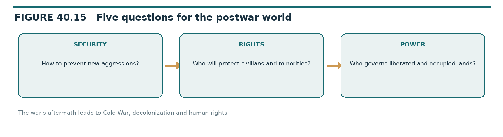

World War II must be understood simultaneously as a war of conquest, an industrial and logistical struggle, a series of regional conflicts, a contest among political systems, and a catastrophe for civilian populations. Its geography stretched from European cities and the eastern front to China, the Pacific islands, North Africa and the oceans. The Holocaust illustrates how a state with modern bureaucratic and technical capacity could pursue genocidal purposes, while rescue and resistance show that human agency persisted under extraordinary danger. Neither technological sophistication nor national strength is a guarantee of moral restraint.

Keep five questions for later chapters. How can international systems restrain aggressive powers? How do political ideologies redefine who deserves protection? What happens when the resources of an industrial state are organized for total war? Why do different communities remember the same events differently? What obligations follow when a government has participated in atrocity? These questions carry forward into the Cold War, decolonization, human rights, warfare, geopolitics and the study of political institutions. The end of 1945 was not the end of history; it was the beginning of a new global arrangement shaped by unprecedented suffering and extraordinary choices. \[<a href="/040-world-war-ii-and-the-holocaust/sources/#source-1" class="cite">1</a>\]\[<a href="/040-world-war-ii-and-the-holocaust/sources/#source-36" class="cite">36</a>\]

<figure class="figure" id="figure-40-15">

<figcaption>Figure 40.15. Five questions for the postwar world. The war's aftermath leads to Cold War, decolonization and human rights. <a class="figure-anchor" href="#figure-40-15" aria-label="Link to this figure">#</a></figcaption>
</figure>
