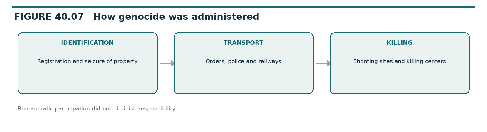

By 1941–1942 Nazi leaders had moved to organized, Europe-wide mass murder. The Wannsee Conference of January 1942 coordinated policy across German agencies; it did not mark the first moment at which killing began. At killing centers in occupied Poland—among them Chełmno, Bełżec, Sobibór, Treblinka and Auschwitz-Birkenau—people were murdered on an enormous scale, often shortly after arriving. Other concentration camps were used for imprisonment, forced labor, and murder, but not all were purpose-built extermination centers. Accurate language prevents historical distortion.

Deportation trains, confiscation, guards and rail infrastructure were tools of genocide. The SS directed the killing system, but participation extended to railway services, civilian officials, police and collaborators. At the same time survivors escaped, some local people hid Jews despite extreme danger, and resistance networks gathered information. The mass murder of Jews continued even as Germany's military situation deteriorated, revealing that Nazi ideological goals could override immediate wartime economic needs. The number six million is based on cumulative documentary and demographic evidence, not a literal master list of every victim. \[<a href="/040-world-war-ii-and-the-holocaust/sources/#source-20" class="cite">20</a>\]\[<a href="/040-world-war-ii-and-the-holocaust/sources/#source-23" class="cite">23</a>\]

<figure class="figure" id="figure-40-7">

<figcaption>Figure 40.7. How genocide was administered. Bureaucratic participation did not diminish responsibility. <a class="figure-anchor" href="#figure-40-7" aria-label="Link to this figure">#</a></figcaption>
</figure>
