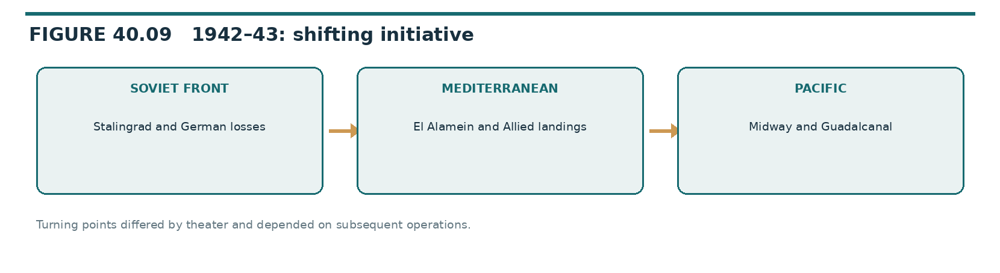

By late 1942 the Axis powers faced several serious reversals. At El Alamein British-led forces stopped the Axis advance in Egypt; the Allied landings in French North Africa applied additional pressure. In the Pacific, Midway and Guadalcanal reduced Japan's offensive freedom. In the Soviet Union, German forces fighting in and around Stalingrad became increasingly exposed to counterattack. A Soviet encirclement in November 1942 and the German surrender in early 1943 turned Stalingrad into a profound military and psychological defeat for Nazi Germany.

Calling 1942 a single 'turning point' risks oversimplification. The Axis still controlled vast territories and possessed substantial armies. Allied offensives in one theater did not immediately produce victory elsewhere. Soviet and Western leaders disagreed about opening a major new front in France, and campaigns in Italy and the Mediterranean continued for years. The correct question is what changed: the balance of industrial output, availability of ships and fuel, attrition of trained personnel, security of supply routes and the ability to choose future operations. These trends shifted at different speeds across the globe. \[<a href="/040-world-war-ii-and-the-holocaust/sources/#source-3" class="cite">3</a>\]\[<a href="/040-world-war-ii-and-the-holocaust/sources/#source-17" class="cite">17</a>\]

<figure class="figure" id="figure-40-9">

<figcaption>Figure 40.9. 1942–43: shifting initiative. Turning points differed by theater and depended on subsequent operations. <a class="figure-anchor" href="#figure-40-9" aria-label="Link to this figure">#</a></figcaption>
</figure>
