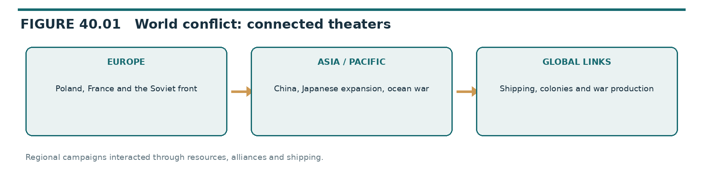

A war becomes global not merely because soldiers fight far from home but because separate theaters affect one another through supplies, diplomacy, trade and strategic decisions. British defense in Europe drew on troops, materials and shipping from an empire spanning several oceans. Japan's campaigns depended on access to fuel and raw materials; United States embargoes and naval strength shaped Japanese planning. German armies sought Soviet territory and resources, while the Soviet war effort depended on domestic production and foreign assistance. A failure at sea could starve a land army of vehicles and fuel thousands of kilometers away.

The familiar division into the Allied and Axis coalitions is helpful but incomplete. The principal Axis powers were Germany, Italy and Japan, with additional governments joining or cooperating to varying degrees. The Allied coalition eventually included Britain and its empire and Commonwealth partners, China, the Soviet Union, the United States, and numerous governments and resistance movements. Membership and military objectives changed over time. France suffered occupation and developed rival authorities; Italy switched sides following the collapse of Mussolini's regime; Bulgaria joined the Axis but changed its military alignment in 1944. Coalition labels must be paired with chronology, local interests and actual conduct. \[<a href="/040-world-war-ii-and-the-holocaust/sources/#source-2" class="cite">2</a>\]\[<a href="/040-world-war-ii-and-the-holocaust/sources/#source-3" class="cite">3</a>\]

<figure class="figure" id="figure-40-1">

<figcaption>Figure 40.1. World conflict: connected theaters. Regional campaigns interacted through resources, alliances and shipping. <a class="figure-anchor" href="#figure-40-1" aria-label="Link to this figure">#</a></figcaption>
</figure>
