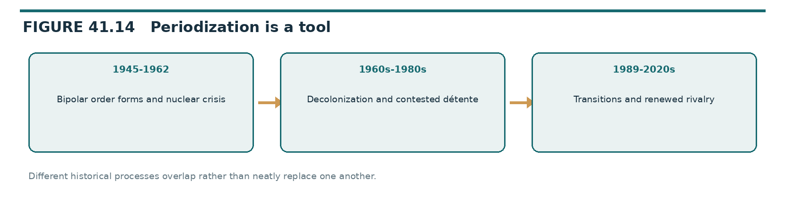

Think in connected layers rather than one memorized list. In 1945 the United Nations was founded and wartime empires began to confront stronger independence demands. During 1947–1949 the Truman Doctrine, Marshall Plan, Berlin blockade, Indian partition, Chinese Revolution and NATO formation created new political realities. The Korean War began in 1950; Bandung met in 1955; the Berlin Wall rose in 1961; and the Cuban Missile Crisis of 1962 revealed the nuclear danger. Many African states gained independence during the 1950s–1970s, while the Vietnam War intensified and then ended in 1975.

Soviet-Afghan war followed the 1979 intervention; reforms under Gorbachev began in 1985; communist rule collapsed across Eastern Europe in 1989; German reunification occurred in 1990; and the USSR dissolved in 1991. The European Union began in 1993, while the wars of Yugoslav dissolution shook the Balkans. Bulgaria joined NATO in 2004 and the EU in 2007. Later crises, including Russia's full-scale invasion of Ukraine in 2022, remind us that the end of bipolar rivalry did not abolish territorial warfare. The timeline is a scaffold; explaining the causal connections is the real educational goal.

<figure class="figure" id="figure-41-14">

<figcaption>Figure 41.14. Periodization is a tool. Different historical processes overlap rather than neatly replace one another. <a class="figure-anchor" href="#figure-41-14" aria-label="Link to this figure">#</a></figcaption>
</figure>
