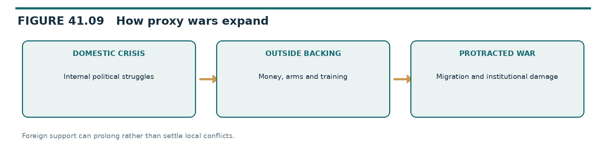

In 1979 the Soviet Union intervened militarily in Afghanistan to support a communist government confronting widespread rebellion and internal conflict. Afghan resistance was diverse, and its fighters received backing from Pakistan, the United States, Saudi Arabia and others. The war caused enormous displacement and destruction, undermined Soviet legitimacy and failed to establish a durable political order. Moscow withdrew its combat forces in 1989; civil war and subsequent Taliban rule demonstrated that a foreign withdrawal is not equivalent to peace.

The Iranian Revolution in 1979 replaced the monarchy with an Islamic Republic, shifting Middle Eastern politics. The Iran-Iraq War from 1980 to 1988 killed vast numbers and involved chemical weapons, outside arms supplies and disputes over territory and regional power. Meanwhile Soviet and American leaders resumed sharper confrontation during episodes of nuclear modernization and regional intervention. The 1980s were therefore not simply a replay of the 1950s: Islamism, energy politics, debt crises and regional movements had become central parts of the global system.

<figure class="figure" id="figure-41-9">

<figcaption>Figure 41.9. How proxy wars expand. Foreign support can prolong rather than settle local conflicts. <a class="figure-anchor" href="#figure-41-9" aria-label="Link to this figure">#</a></figcaption>
</figure>
