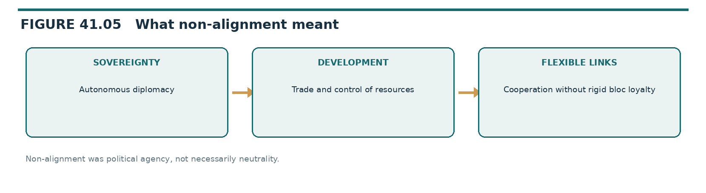

In April 1955 delegates from twenty-nine Asian and African governments met at Bandung in Indonesia to discuss peace, sovereignty, racism, development and opposition to colonialism. The conference did not produce a single unified bloc, and its participants often disagreed sharply. Yet it signaled that recently independent states would not necessarily define their choices through the priorities of Washington and Moscow. The Non-Aligned Movement was formally founded in 1961, with leaders including Tito, Nehru, Nasser, Sukarno and Nkrumah associated with its origins.

Non-alignment did not mean neutrality on every issue or refusing all superpower assistance. Countries could receive aid, purchase weapons and dispute one another's policies while seeking room to maneuver. The term 'Third World' originally carried a political meaning in this context, although its later use as shorthand for poverty obscures the diversity of countries involved. Sovereignty was also an economic question: who controlled oil, mines, trade routes, debt and development finance? The demand for a new international economic order in the 1970s grew out of these disputes.

<figure class="figure" id="figure-41-5">

<figcaption>Figure 41.5. What non-alignment meant. Non-alignment was political agency, not necessarily neutrality. <a class="figure-anchor" href="#figure-41-5" aria-label="Link to this figure">#</a></figcaption>
</figure>
