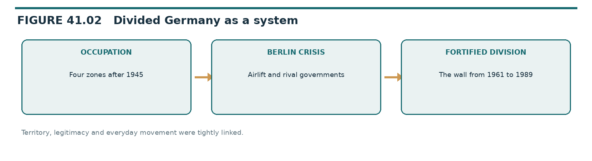

Postwar Germany was initially administered through occupation zones. In 1948 Soviet authorities blocked most land access to the western sectors of Berlin, which lay inside the Soviet occupation zone. Western allies answered with an extensive airlift rather than abandoning the city or attempting a military breakthrough. The blockade ended in 1949. Two German states then emerged: the Federal Republic of Germany in the west and the German Democratic Republic in the east, each embedded in a larger alliance structure.

NATO was formed in 1949 as a collective-defense alliance; the Warsaw Pact followed in 1955 under Soviet leadership. These were not perfect mirror images: the nature of decision-making, internal sovereignty and the treatment of member-state dissent differed. In 1961 East German authorities erected the Berlin Wall to stem emigration and control movement, turning divided Berlin into a powerful symbol of Europe's political geography. Military deterrence, economic integration, and legitimacy at home became parts of the same contest.

<figure class="figure" id="figure-41-2">

<figcaption>Figure 41.2. Divided Germany as a system. Territory, legitimacy and everyday movement were tightly linked. <a class="figure-anchor" href="#figure-41-2" aria-label="Link to this figure">#</a></figcaption>
</figure>
