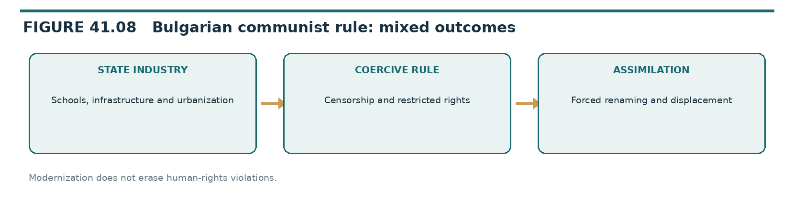

In the 1980s the Bulgarian communist authorities intensified coercive policies toward Turkish and other Muslim communities. During the so-called 'Revival Process', many people were forced to replace their names and faced restrictions on language, religious practice and cultural expression. Resistance brought detention and violence. In 1989 the regime pressured and enabled the departure of large numbers of Bulgarian Turks to Turkey, an episode frequently described as the 'Big Excursion' in official euphemism but investigated by scholars as forced displacement and ethnic cleansing.

This history should not be presented as an ordinary voluntary migration or as a harmless modernization policy. It also should not suggest all Bulgarians endorsed the campaign; opposition, fear and varying local experiences existed. The regime's justification rested on claims about national identity and assimilation that denied citizens the right to determine their own cultural affiliation. The policy was officially reversed after Todor Zhivkov's removal from power in November 1989. Its aftermath remains important for minority rights, historical memory, trust in institutions and Bulgaria's relationship with Turkey.

<figure class="figure" id="figure-41-8">

<figcaption>Figure 41.8. Bulgarian communist rule: mixed outcomes. Modernization does not erase human-rights violations. <a class="figure-anchor" href="#figure-41-8" aria-label="Link to this figure">#</a></figcaption>
</figure>
