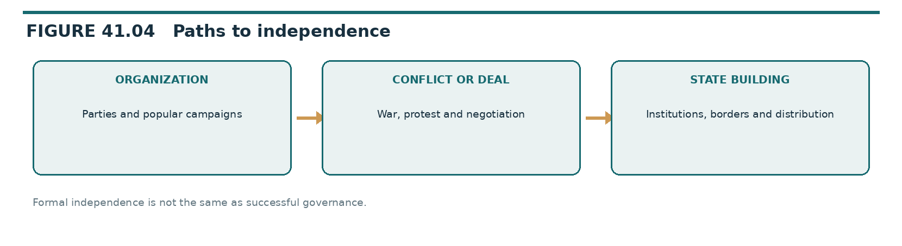

In 1945 hundreds of millions of people lived under colonial rule. Colonial subjects had served in world wars, produced essential supplies and built political organizations that demanded equal rights or sovereignty. European exhaustion weakened imperial control, while new international principles made colonial rule increasingly difficult to justify. Yet independence was not a gift granted by Washington or Moscow. African, Asian, Caribbean and Pacific movements negotiated, organized strikes, fought wars, debated constitutions and developed competing visions of their futures.

The United Nations became an important forum, especially through its 1960 Declaration on the Granting of Independence to Colonial Countries and Peoples. The UN reports that more than eighty former colonies have gained independence since its establishment. These numbers describe a huge political transformation, but not a universal process: former dependencies had differing legal status, and several territories remain on the UN list of Non-Self-Governing Territories. Independence did not automatically provide land redistribution, economic equality, functioning administrations or secure national borders. New states inherited varied educational systems, export economies and sometimes contested frontiers.

<figure class="figure" id="figure-41-4">

<figcaption>Figure 41.4. Paths to independence. Formal independence is not the same as successful governance. <a class="figure-anchor" href="#figure-41-4" aria-label="Link to this figure">#</a></figcaption>
</figure>
