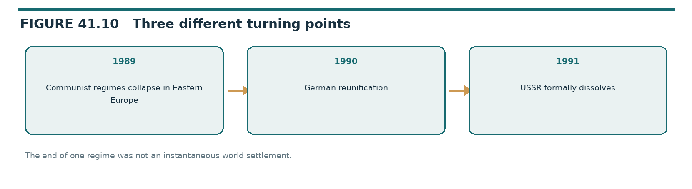

Germany reunited on 3 October 1990 following diplomatic negotiations among the two German states and the four powers that had held postwar rights. The process required decisions about alliance membership, borders, currency, public property and the fate of former East German institutions. For many citizens reunification meant new rights and opportunities; for others it also meant unemployment, dislocation and a difficult renegotiation of identity. The Berlin Wall could be removed more quickly than the disparities between two long-divided economies.

Within the Soviet Union, republican nationalist movements, fiscal problems, elite struggles and reforms eroded central authority. A failed conservative coup in August 1991 further weakened the union. By December 1991 the USSR dissolved and its constituent republics became independent states. The event did not mean that Russian power, nuclear weapons, geopolitical interests or ethnic and territorial disputes disappeared. The distinction between ending an ideological bloc and creating a peaceful international order is central to the next decades.

<figure class="figure" id="figure-41-10">

<figcaption>Figure 41.10. Three different turning points. The end of one regime was not an instantaneous world settlement. <a class="figure-anchor" href="#figure-41-10" aria-label="Link to this figure">#</a></figcaption>
</figure>
