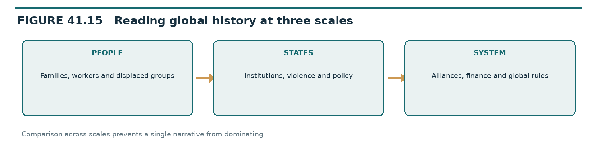

Three approaches help prevent distortion. First, change scale. A diplomat may see a treaty as success; a displaced family may remember an unfinished war; a factory worker may describe technological progress and unemployment in the same lifetime. Second, compare political projects with outcomes rather than judging societies only by stated ideals. Third, examine institutions. A revolution's promise of equality matters, but so do the electoral laws, police powers, land registries, trade arrangements and schools that shape everyday experience.

Finally, remember that historical explanation is not moral equivalence. State violence, forced assimilation, racial discrimination, democratic participation and humanitarian cooperation should be described with appropriate evidence and ethical clarity. The twentieth century after 1945 was neither a simple march toward liberty nor an unbroken descent into conflict. It was an era of extraordinary human agency, success, failure and unfinished arguments about who governs, who benefits and what makes international order legitimate. That is the bridge into the chapters on geopolitics that follow.

<figure class="figure" id="figure-41-15">

<figcaption>Figure 41.15. Reading global history at three scales. Comparison across scales prevents a single narrative from dominating. <a class="figure-anchor" href="#figure-41-15" aria-label="Link to this figure">#</a></figcaption>
</figure>
