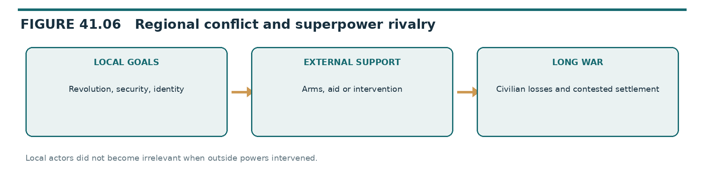

In the Middle East, the end of wartime mandates, Jewish and Arab nationalist movements, oil revenues and competition among regional governments shaped postwar politics. The founding of Israel in 1948 followed the UN partition plan, civil conflict in Mandatory Palestine and a regional war; Palestinians experienced mass displacement and dispossession known as the Nakba. This established questions of refugees, borders, security and political rights that would remain unresolved through later wars. The 1956 Suez Crisis showed that Britain and France could no longer simply impose their will on Egypt without facing U.S. and Soviet pressure.

Egypt's Gamal Abdel Nasser promoted Arab nationalism and state-led development; other governments followed monarchic, republican, socialist or Islamist paths. Iranian politics included the 1953 overthrow of Prime Minister Mohammad Mosaddegh after struggles over oil nationalization, with British and American involvement, and the 1979 revolution that created an Islamic Republic. In the 1970s oil price shocks revealed how producers and consumers depended on each other. Regional conflicts had their own histories even when superpowers supplied weapons and diplomatic backing.

<figure class="figure" id="figure-41-6">

<figcaption>Figure 41.6. Regional conflict and superpower rivalry. Local actors did not become irrelevant when outside powers intervened. <a class="figure-anchor" href="#figure-41-6" aria-label="Link to this figure">#</a></figcaption>
</figure>
