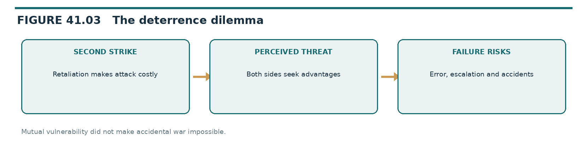

Atomic weapons transformed strategic calculations. The United States had used atomic bombs in 1945; the Soviet Union tested its first atomic device in 1949. Hydrogen bombs, long-range bombers, ballistic missiles and submarine-launched systems later gave both sides a capacity for catastrophic destruction. Deterrence depended on persuading an opponent that an attack would provoke unacceptable retaliation. A credible second-strike capability could discourage a first strike, but it also required dangerous deployments and complicated command arrangements.

Mutually assured destruction is often invoked as if it guaranteed peace. It did not. Accidents, mistaken warnings, unauthorized launches, misperceptions and escalations during conventional crises remained serious hazards. Governments invested in early-warning networks, hardened communications, arms-control verification and crisis procedures to reduce uncertainty. A central paradox of nuclear strategy is that efforts to become more secure can increase fear on both sides. The absence of nuclear war was an outcome shaped by restraint, institutions and luck—not proof that nuclear weapons created a risk-free international system.

<figure class="figure" id="figure-41-3">

<figcaption>Figure 41.3. The deterrence dilemma. Mutual vulnerability did not make accidental war impossible. <a class="figure-anchor" href="#figure-41-3" aria-label="Link to this figure">#</a></figcaption>
</figure>
