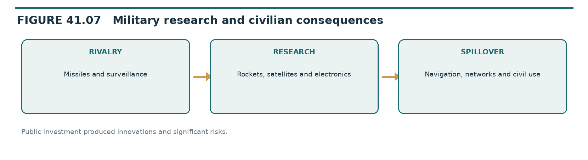

Competition between the superpowers funded nuclear weapons, rockets, satellites, computers, radar and specialized research. The Soviet launch of Sputnik in 1957 and Yuri Gagarin's orbital flight in 1961 raised the status of Soviet science; the American Apollo 11 landing in 1969 became an emblem of U.S. technological and organizational capacity. Universities, contractors and military laboratories formed networks whose inventions later influenced civilian communications, medicine and electronics.

Scientific achievement could not be separated from political institutions and human costs. Nuclear testing exposed communities to radiation, military research competed with other budget needs, and public information was often classified. Citizens were also drawn into ideological spectacles: schoolchildren learned civil-defense drills, athletic medals became symbolic victories, and artistic tours advertised national culture. The lesson is not that technology is merely propaganda; it is that innovation requires institutions, education, capital and social choices. Scientific progress can improve daily life while remaining embedded in militarized competition.

<figure class="figure" id="figure-41-7">

<figcaption>Figure 41.7. Military research and civilian consequences. Public investment produced innovations and significant risks. <a class="figure-anchor" href="#figure-41-7" aria-label="Link to this figure">#</a></figcaption>
</figure>
