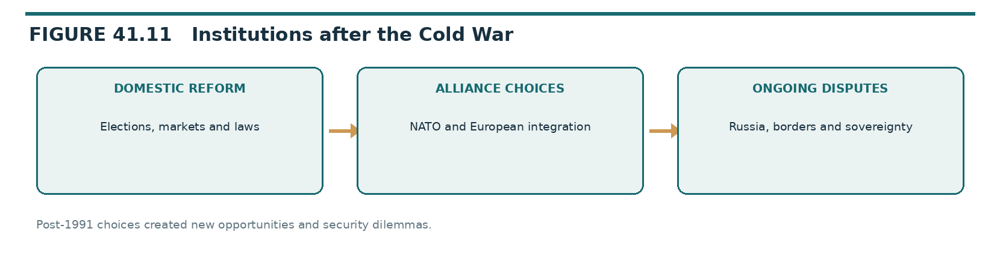

European integration accelerated after the Cold War. The Maastricht Treaty, signed in 1992 and taking effect in 1993, created the European Union and laid foundations for deeper political and monetary cooperation. The EU later enlarged to include many former communist states. NATO also expanded eastward as new democracies sought security guarantees, while Russian leaders increasingly treated the expansion as a threat. These competing positions help explain later diplomatic disputes without implying that states lacked agency to seek alliances or that every subsequent conflict was inevitable.

Bulgaria joined NATO in 2004 and the European Union in 2007, gaining access to common institutions and markets while accepting shared commitments. The country continued to face domestic challenges involving governance, regional disparities and demographic change. Integration can expand opportunities without ending national decision-making or settling all political disagreements. For historical comparison, distinguish why individual states applied for membership, how existing members negotiated enlargement, and what consequences followed in different periods.

<figure class="figure" id="figure-41-11">

<figcaption>Figure 41.11. Institutions after the Cold War. Post-1991 choices created new opportunities and security dilemmas. <a class="figure-anchor" href="#figure-41-11" aria-label="Link to this figure">#</a></figcaption>
</figure>
