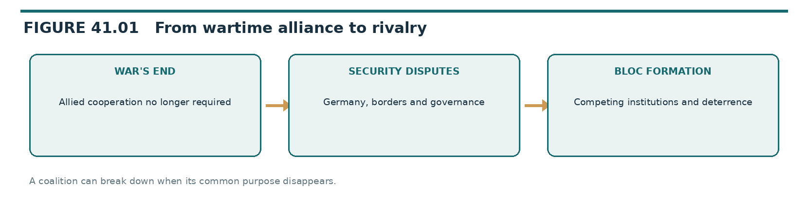

In 1945 the United States possessed unmatched industrial capacity, global military bases, and the only deployed atomic weapons. The Soviet Union emerged victorious but devastated by fighting and mass death; its forces occupied much of Central and Eastern Europe. Britain and France retained worldwide possessions but faced financial and political exhaustion. China had endured a long war with Japan and was again divided by civil conflict. Many societies in Asia and Africa expected wartime promises of freedom and self-determination to apply beyond Europe.

The wartime coalition had cooperated against Nazi Germany despite deep disagreements over political institutions and security. With that common enemy gone, its members interpreted German reconstruction, Polish borders, elections and the future of occupied territories differently. Soviet leaders sought security against another western invasion, and their methods created insecurity for countries subjected to Moscow's control. American leaders feared expansion of Soviet-backed communist regimes, even while their alliances often included colonial powers and authoritarian governments. A security dilemma developed: steps one side called defensive could look offensive to the other. Understanding this does not make coercion and voluntary alliance identical.

<figure class="figure" id="figure-41-1">

<figcaption>Figure 41.1. From wartime alliance to rivalry. A coalition can break down when its common purpose disappears. <a class="figure-anchor" href="#figure-41-1" aria-label="Link to this figure">#</a></figcaption>
</figure>
