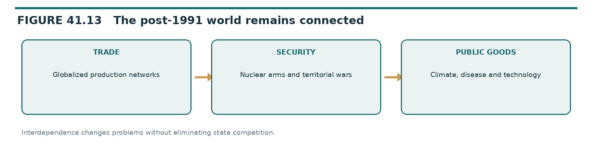

By 1991 the European colonial map had been fundamentally transformed, the Soviet-led bloc had collapsed, Germany was unified and the United States occupied an unusually powerful international position. International institutions were more extensive than in 1945, and global trade and scientific networks were expanding. Yet political independence did not guarantee economic autonomy; nuclear arsenals survived; borders and historical grievances remained contested; and authoritarian power did not disappear with Soviet communism.

The deepest lesson is that historical periods overlap. Decolonization did not simply end when the Cold War ended, and Cold War institutions continued shaping the post-1991 system. A country could become independent, remain economically dependent, and still exercise creative diplomatic agency. A society could become wealthier while some citizens lost political rights. This chapter completes the book's chronological survey, preparing us to analyze recurring structures rather than repeat a linear timeline. In Part IV we will examine the mechanisms behind war, peace, security, geography and international power—using the history of 1945 and after as evidence rather than as an invitation to easy certainty.

<figure class="figure" id="figure-41-13">

<figcaption>Figure 41.13. The post-1991 world remains connected. Interdependence changes problems without eliminating state competition. <a class="figure-anchor" href="#figure-41-13" aria-label="Link to this figure">#</a></figcaption>
</figure>
