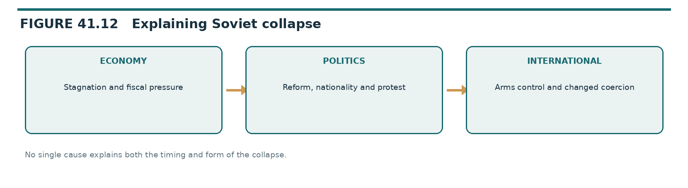

Historians disagree about the relative importance of economic stagnation, military spending, civic resistance, Soviet reform, Western pressure, nationalism and the information environment in ending the Cold War. Several explanations can be partly true without being interchangeable. Evidence about government finance cannot alone explain the timing of a peaceful border opening; evidence about a political leader's speeches cannot alone explain the collapse of a multinational state. Good historical analysis asks what changed, through which mechanisms, and why events accelerated during 1989–1991 rather than some earlier decade.

Consider two counterfactuals. If Soviet leaders had chosen to invade neighboring states again in 1989, the transitions might have been bloodier and slower. If reform had not challenged economic planning and party privilege, the system might have remained more coercively stable for a time, yet could still have faced deep legitimacy problems. Counterfactuals are not facts about alternate histories; they are tests of causal reasoning. Their value lies in identifying which factors seem necessary or important, not in pretending to know exactly what would have happened.

<figure class="figure" id="figure-41-12">

<figcaption>Figure 41.12. Explaining Soviet collapse. No single cause explains both the timing and form of the collapse. <a class="figure-anchor" href="#figure-41-12" aria-label="Link to this figure">#</a></figcaption>
</figure>
