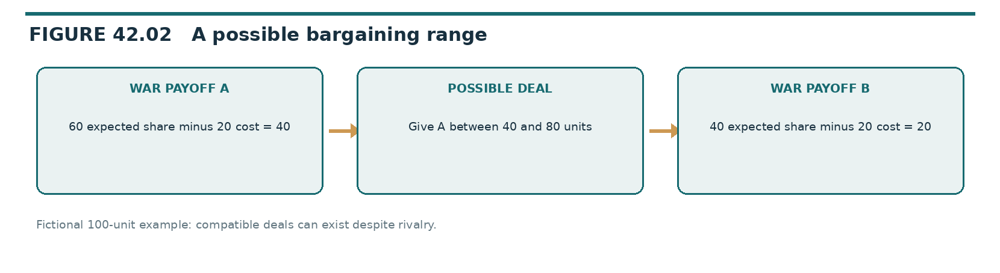

Imagine a disputed asset worth 100 units to the parties combined. Country A believes it has a 60 percent chance of obtaining the asset through war and expects to lose 20 units in fighting. Its expected payoff from war is therefore 60 minus 20, or 40. Country B expects to retain 40 percent and would also lose 20, giving it an expected payoff of 20. A negotiated division giving A between 40 and 80 units and giving B the remainder would leave both at least as well off as their expectations from war. That interval is the bargaining range. The figures are hypothetical and are not estimates for a historical conflict.

Notice the sensitivity of the result to beliefs. If Country A thinks victory is almost guaranteed while Country B believes the same about itself, each may demand a share too large for the other to accept. If the asset's value changes because it controls water, oil or a vital military position, agreement may be harder. If a treaty cannot be enforced, a bargain that looks attractive today may seem ruinous tomorrow. A mathematical model does not reduce human life to numbers; it makes our assumptions visible so that a vague explanation such as 'war was unavoidable' can be examined more carefully.

<figure class="figure" id="figure-42-2">

<figcaption>Figure 42.2. A possible bargaining range. Fictional 100-unit example: compatible deals can exist despite rivalry. <a class="figure-anchor" href="#figure-42-2" aria-label="Link to this figure">#</a></figcaption>
</figure>
