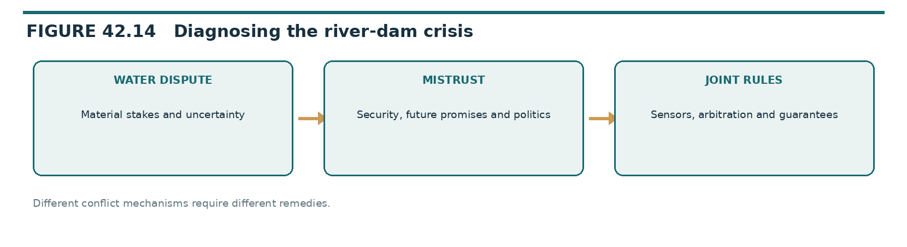

Imagine two states sharing a river. Country A builds a dam upstream, claiming it needs electricity and flood protection. Country B fears that water releases could devastate its farms and regards the dam as a potential weapon. Military patrols increase near the border. The president of A promises not to disrupt water flow, but B distrusts the promise because A's government could change. Domestic parties in both countries call negotiation a surrender. This teaching scenario is fictional, designed to combine several mechanisms introduced in the chapter.

Now diagnose the case in layers. The material dispute concerns water and electricity; the security dilemma arises because protective infrastructure seems threatening; the commitment problem concerns future management of the dam; domestic politics make compromise dangerous for leaders; incomplete hydrological data create an information problem. Possible remedies include a joint river commission, sensors accessible to both sides, a binding water-release schedule, independent arbitration, and emergency communications. None guarantees peace, but each targets a specific mechanism. A strong diagnosis should distinguish preventing the outbreak of violence from constructing arrangements that remain credible afterward.

<figure class="figure" id="figure-42-14">

<figcaption>Figure 42.14. Diagnosing the river-dam crisis. Different conflict mechanisms require different remedies. <a class="figure-anchor" href="#figure-42-14" aria-label="Link to this figure">#</a></figcaption>
</figure>
