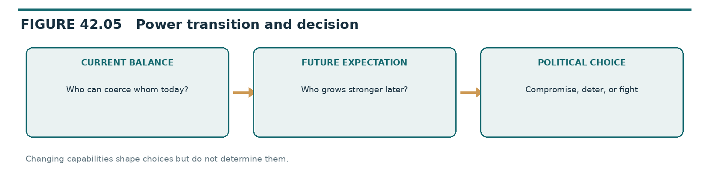

Some theories emphasize the distribution of power across the international system. A dominant power may try to prevent challengers from growing, while a rising state may seek changes to rules and borders that it considers unfair. Transition periods can be particularly dangerous if both sides expect the future balance to differ sharply from the present. Nevertheless, rising power is not a universal cause of war. Historical cases include peaceful accommodations, costly stand-offs and wars, and they differ in institutions, geography and intentions. \[<a href="/042-why-wars-begin/sources/#source-2" class="cite">2</a>\]

The number of major powers—sometimes described as bipolarity, multipolarity or unipolarity—can influence strategic calculations without determining outcomes. A multipolar system gives states several potential partners but may create uncertainty about commitments; a bipolar contest concentrates competition but can encourage cautious deterrence. No simple formula predicts war from the number of great powers. Leaders must choose how to respond to systemic pressures, and domestic and personal factors often help explain why apparently similar power shifts produce different outcomes.

<figure class="figure" id="figure-42-5">

<figcaption>Figure 42.5. Power transition and decision. Changing capabilities shape choices but do not determine them. <a class="figure-anchor" href="#figure-42-5" aria-label="Link to this figure">#</a></figcaption>
</figure>
